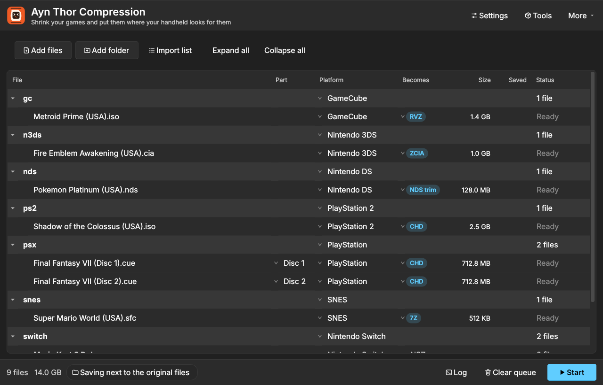
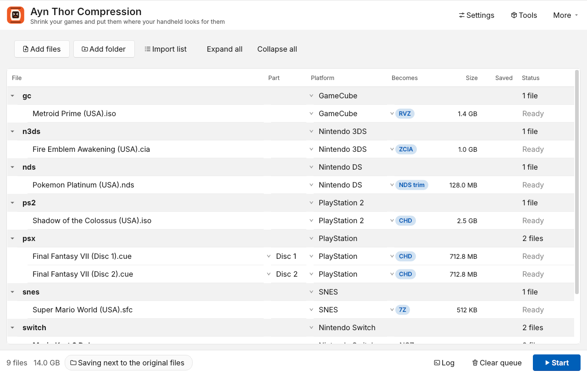
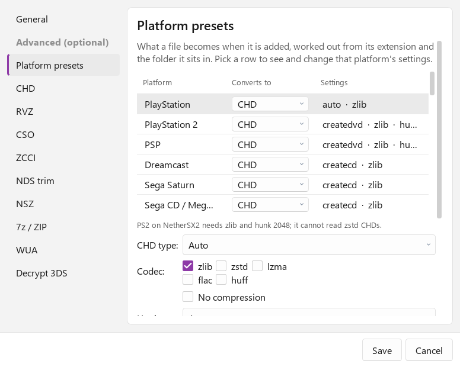

<p align="center">

</p>

<h1 align="center">Ayn Thor Compression</h1>

<p align="center">
<a href="https://github.com/asa07-salihg/Ayn-Thor-Compression/actions/workflows/ci.yml"></a>
<a href="https://github.com/asa07-salihg/Ayn-Thor-Compression/releases/latest"></a>
</p>

<p align="center">
Ayn Thor Compression is a free Windows app that shrinks ROMs into the formats
emulators read, and puts them where your handheld looks for them. Each system
wants its own format and its own program: CHD from chdman, RVZ from
DolphinTool, NSZ from nsz, ZCCI for 3DS. Add the files to one queue and the
app runs the right tool for each one.
</p>

<p align="center">
Plug an Android handheld in with a USB cable and the games can go straight
onto it, into the ES-DE <code>ROMs</code> folder on its SD card. No card reader,
no copying by hand.
</p>

<p align="center">
Each format comes from the project that defined it, with the flags that
emulator needs.
</p>

<p align="center">
The default formats come from filling an <a href="https://www.ayntec.com/">Ayn Thor</a>
handheld. They are the same on every model in the range, and you can change
any of them under <strong>Settings &gt; Platform presets</strong>.
</p>

<p align="center">
<a href="#download">Download</a> ·
<a href="#supported-formats">Formats</a> ·
<a href="#legal">Legal</a> ·
<a href="#running-from-source">From source</a> ·
<a href="CHANGELOG.md">Changelog</a>
</p>

<p align="center">

</p>

<p align="center">
The format for each file is set when you add it. Click the <strong>Becomes</strong> cell to
change it, or right-click the row for that list and the other row actions.
Drop a folder in and press Start.
</p>

<p align="center">
On first launch, the setup guide installs the converter programs, asks for
your ROMs folder (SD card, USB drive, or this PC), and looks for Switch keys.
Press Start and the app lists problems it can already see, with a button for
each one. Click <strong>Failed</strong> on a row to read what went wrong.
</p>

<p align="center">
Light and dark follow the Windows setting, and the accent colour comes from
yours:
</p>

<p align="center">

</p>

## Send games to your handheld over USB

An Android handheld on a USB cable shows up in Explorer as a device, not a
drive, so most PC tools can't write to it. This app can.

1. Plug the handheld in, unlock it, and pick **File transfer** in the USB
   notification on it.
2. Click the destination at the bottom of the window and choose
   **Straight onto my handheld**. The SD card is picked for you if it already
   has a `ROMs` folder.
3. Press Start. Each game is converted on the PC first and then sent into the
   folder for its console, so `psx` games land in `ROMs/psx`.

A game that is already on the handheld is skipped. A file that is already in
the right format, like a `.chd` or a `.rvz`, is sent as it is. A cue sheet
goes with every `.bin` it lists. It works with any Android device that
Windows shows under This PC, the Ayn Thor, Odin and Retroid Pocket included.

## Legal

- No ROMs, console keys or copyrighted game data are distributed with this
  project, and none are downloaded by it.
- Nintendo Switch support needs a `prod.keys` file that you dump from a console
  you own. The app never ships one, never fetches one, and never uploads one.
  See [SECURITY.md](SECURITY.md).
- The 3DS decryption step removes encryption from files you already have. It
  does not break any protection on a device and does not obtain anything.
- Use this on games you own.

## Download

Get `AynThorCompression.exe` from
[Releases](https://github.com/asa07-salihg/Ayn-Thor-Compression/releases/latest)
and run it. There is no installer and no Python to set up.

Each release is built by GitHub Actions from the tagged source and published
with a `SHA256SUMS.txt` next to it, so you can check what you downloaded:

```powershell
Get-FileHash .\AynThorCompression.exe -Algorithm SHA256
```

The exe is not code-signed, so SmartScreen will warn on first run.

## Supported formats

| Format | Systems | Produced by | Why this one |
|---|---|---|---|
| **CHD** | PS1, PS2, PSP, Dreamcast, Saturn, Sega CD, PC Engine CD, Neo Geo CD, 3DO | chdman | One file instead of a cue/bin pair, and every mainstream disc emulator reads it |
| **RVZ** | GameCube, Wii | DolphinTool | Drops the junk padding Nintendo discs are full of; GCZ and WBFS keep it |
| **CSO / ZSO** | PSP, PS2 | maxcso | Smaller than CHD on PSP, and PPSSPP reads it natively |
| **ZCCI** | Nintendo 3DS | rom-converto | The only compressed 3DS format Azahar loads directly |
| **NSZ / XCZ** | Nintendo Switch | nsz | Recompresses NCA contents while leaving signatures intact, so installers still accept it |
| **7z** | SNES, GBA, GB, GBC, Mega Drive, Master System, Game Gear, 32X, PC Engine | 7-Zip | Cartridge ROMs are plain data; RetroArch opens 7z transparently |
| **ZIP** | Arcade, Neo Geo, CPS, FBNeo, MAME | 7-Zip | Those cores expect a zipped romset and will not look inside a 7z |
| **WUA** | Wii U | rom-converto | Packs game, update and DLC into one archive Cemu mounts as a single title |

Two steps prepare a file rather than shrink it:

| Step | Applies to | Why it exists |
|---|---|---|
| **Decrypt 3DS** | `.cia`, `.3ds`, `.cci` | A cart dumped from a console is encrypted, and encrypted data does not compress. This has to run before ZCCI |
| **NDS trim** | `.nds` | melonDS will not read an archive, so trimming the unused tail of the cart is the only saving available |

You can expand a compressed file again. Drop a `.chd` in and the row reads
**CHD (decompress)**, which writes the cue/bin back out. The same applies to
`.rvz`, `.cso`, `.zso`, `.nsz`, `.xcz`, and ZCCI, which come back byte for
byte. Cartridge `.7z` and `.zip` files stay as they are, because RetroArch and
MAME read them that way. Click **Becomes** and pick *Unzip instead of convert*
when you want one of those expanded. WUA cannot be reversed.

N64 stays an uncompressed `.z64`. That is the file those emulators read.

## Settings

One settings window: a General page, a **Platform presets** page, and a page per
format. You can use the app with the defaults. Everything except General is
under **Advanced**.

<p align="center">

</p>

**Platform presets** is the table auto-detection uses. A file in `ROMs/ps2`
becomes a zlib CHD with hunk 2048. A file in `ROMs/gc` becomes a level 5 zstd
RVZ. Every row is editable. Rows you have changed are marked with an asterisk,
and any row can be put back. Several defaults exist for one specific emulator.

Per-format pages hold that tool's own flags. Saving applies only the pages you
edited to files already queued, so changing an RVZ setting will not overwrite
the codec a PS2 row was given for NetherSX2.

## Updating

**More > Check for updates** asks GitHub whether a newer release exists. If
there is one it shows the version and the release notes, and can replace this
executable with it.

The download is checked against the `SHA256SUMS.txt` published with that
release before the exe is replaced. A release without that file is reported
and left uninstalled. The app checks only when you ask, and it installs only
after you press the button.

Because releases are plain GitHub releases with a stable asset name
(`AynThorCompression.exe`), an external release tracker can follow this project
without any extra setup.

## Getting the tools

The converters are not bundled with the repository. The setup guide installs
them on first launch; after that, open **Tools**, or run:

```powershell
python scripts/fetch_tools.py
```

Each download is checked against a SHA-256 recorded in
[`manifest.py`](src/aynthor/core/tools/manifest.py) before it is written to
disk. Versions are pinned, so a tool changes only when that checksum changes
in the project. One entry cannot be verified, and the Tools window says which
and why.

[THIRD-PARTY-NOTICES.md](THIRD-PARTY-NOTICES.md) lists every tool, its version,
its licence, and how to re-derive the hashes yourself.

## Importing a list

If you keep a list of what you are putting on the device, **Import List** reads
it, finds each game in your ROMs folder, and queues it with that platform's
settings. Both of these shapes work:

```
Chrono Cross -> psx -> CHD
| Chrono Cross | psx | CHD | done |
```

Folder names follow the
[ES-DE layout](https://github.com/retrogamecorps/ES-DE-Directories), and the
alternatives are handled: SNES is found in `snes` or `sfc`, Mega Drive in
`megadrive` or `genesis`, arcade in `fbneo`, `fba` or `mame`. Point the app at
your SD card and it will find the `ROMs` folder inside it.

Matching is by keyword, so region tags and revision numbers in filenames do not
matter. There is a worked example in [examples/](examples/sample-list.txt).

## Switch

NSZ needs your own `prod.keys`. The app looks in three places:

- next to the exe, or in the project root when running from source
- `%USERPROFILE%\.switch\prod.keys`
- wherever you point it in the NSZ options panel

A Switch title is several files: the base game, an update, and any DLC. They are
compressed separately, and the queue shows which is which so you notice when a
set is missing its base game, which would install as nothing.

## Running from source

```powershell
git clone https://github.com/asa07-salihg/Ayn-Thor-Compression.git
cd Ayn-Thor-Compression
python -m venv .venv
.\.venv\Scripts\Activate.ps1
pip install -e ".[dev]"
python scripts/fetch_tools.py
python -m aynthor
```

Python 3.10 or newer. The tests do not need Qt or a display:

```powershell
pytest
ruff check .
```

## Building the exe

```powershell
pip install -e ".[build]"
python packaging/build_exe.py
```

The result is `dist/AynThorCompression.exe`. The build keeps the Qt modules
the app imports and drops the Qt DLLs it does not use.
[The spec](packaging/AynThorCompression.spec) explains each pass.

Pushing a `v1.2.3` tag makes CI do the same and attach the exe and its checksum
to a release. A release needs both `AynThorCompression.exe` and
`SHA256SUMS.txt`, from the same build and under exactly those names, or the
updater will refuse it.

## Changelog

What changed in each release, newest first: [CHANGELOG.md](CHANGELOG.md). The
running version is in the title bar and under **More > About**, and the same
page opens from **More > What's new**.

## How it is put together

`src/aynthor/core/` is the engine. It does not import Qt, so the tests run
without a display. `src/aynthor/ui/` is the window.

## Contributing

Adding a format is mostly a matter of wrapping a command-line tool: one module
under `core/converters`, one entry in the catalogue, one options panel.
[CONTRIBUTING.md](CONTRIBUTING.md) walks through it.

Bug reports are most useful with the contents of the Log pane. The tool's own
error text is usually the line that matters. Please do not attach ROMs or keys.

Security issues go through [SECURITY.md](SECURITY.md) rather than the issue
tracker.

## Credits

This app is a front end. The work is done by:

[chdman](https://www.mamedev.org/) (MAME) ·
[DolphinTool](https://dolphin-emu.org/) ·
[maxcso](https://github.com/unknownbrackets/maxcso) ·
[7-Zip](https://www.7-zip.org/) ·
[nsz](https://github.com/nicoboss/nsz) ·
[rom-converto](https://github.com/DevYukine/rom-converto) ·
[z3ds_compress](https://github.com/energeticokay/z3ds_compress) ·
[ndstrim](https://github.com/Nemris/ndstrim) ·
[Batch CIA 3DS Decryptor Redux](https://github.com/xxmichibxx/Batch-CIA-3DS-Decryptor-Redux)
and [Project_CTR](https://github.com/3DSGuy/Project_CTR)

Folder layout from
[ES-DE-Directories](https://github.com/retrogamecorps/ES-DE-Directories).
Licences are listed in [THIRD-PARTY-NOTICES.md](THIRD-PARTY-NOTICES.md).

## Support

The app is free. If you want to support the work,
[buy me a coffee](https://buymeacoffee.com/asa07salihg).

## License

MIT. See [LICENSE](LICENSE).
